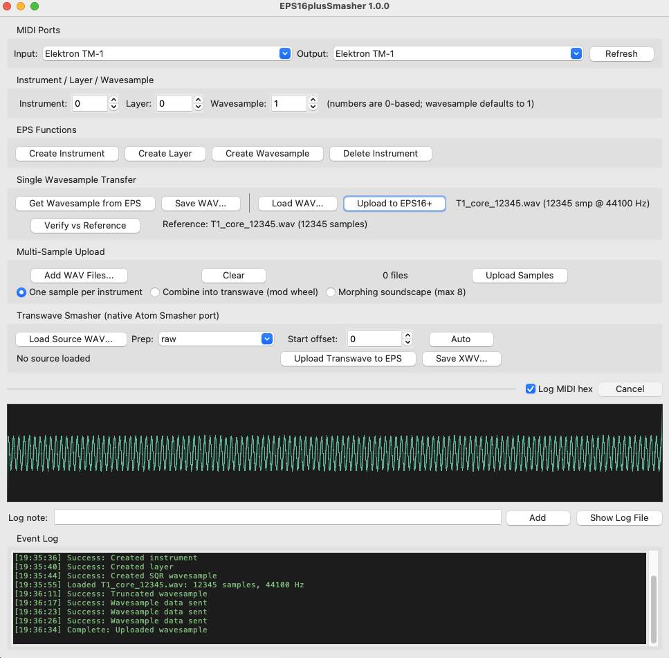

# EPS16plusSmasher

A native Mac app for transferring samples to and from the **Ensoniq EPS-16+**
over MIDI, with a built-in transwave generator. 



## What's new here

- **Native macOS app.** The browser-based EPS16+ sysex utility, ported to a
  standalone app that talks to CoreMIDI directly.
- **Built-in Transwave Smasher.** A dependency-free port of
  [Transwave Atom Smasher](https://github.com/handsthatstrike/Transwave-Atom-Smasher):
  turn any WAV into a transwave of up to 128 frames and send it straight to
  the EPS with mod-wheel scanning set up, or save it as a WAV for disk
  workflows. Frame slicing and frame fades are byte-exact
  with the original Perl/SoX tool.
- **Verified transfers.** A built-in Verify compares what comes back from the
  EPS against what you sent, sample for sample.

## Built on

- [EnsoniqEPS16Plus](https://github.com/summitt/EnsoniqEPS16Plus) by summitt
  (Null Lexicon): the sysex protocol work everything here depends on. If this
  tool is useful to you, please support his work at
  https://patreon.com/null0perat0r
- [Transwave Atom Smasher](https://github.com/handsthatstrike/Transwave-Atom-Smasher)
  by handsthatstrike (MIT license)

Released under the MIT License (see [LICENSE](LICENSE)). See [NOTICE.md](NOTICE.md) for the projects it builds on.

## Hardware test results

Tested November 2026 on a real EPS-16+ through an Elektron TM-1 interface,
from a 2018 Intel Mac mini running macOS 12.6.7 and python.org Python 3.12.10.

| Test | Result |
|---|---|
| Single sample upload, then download | Exact match, all 12,345 samples |
| Transwave Smasher upload, then download | Exact match; mod wheel scans the frames |
| One sample per instrument (3 files) | Each in its own instrument; one verified exact |
| Morphing soundscape (3 files) | Uploaded; LFO morph confirmed by ear |

The test files are in `test_signals/`. See [Testing](#testing) to repeat
these tests yourself.

## Download and install

1. Download `EPS16plusSmasher-1.0.0-macOS.dmg` from this repository's
   **Releases** page.
2. Open it and drag **EPS16plusSmasher** into **Applications**.
3. **First launch:** right-click the app, choose **Open**, then **Open**
   again. The app isn't notarized by Apple, so macOS blocks a plain
   double-click the first time. After that it opens normally.

No Python or Terminal needed. The app is built for Intel Macs and tested on
macOS 12.6.7. On Apple Silicon Macs it should run through Apple's Rosetta 2
translation (macOS offers to install Rosetta if needed), but that hasn't been
tested yet.

## Requirements

- **A MIDI interface** connected both ways: EPS MIDI OUT to interface IN, and
  interface OUT to EPS MIDI IN.
  - Tested: Elektron TM-1.
  - A MOTU Fastlane USB received no replies from the EPS in one test (the
    cause wasn't found), so it isn't supported yet.
- **On the EPS-16+:** sys-ex must be ON (Edit → System•MIDI).

## Run from source (optional)

For developers, or if the app doesn't work on your Mac. Needs
**Python 3.12 from [python.org](https://www.python.org/downloads/release/python-31210/)**:
Homebrew's Python lacks Tkinter, and as of testing `python-rtmidi` had no
prebuilt Mac packages for Python 3.13 or newer.

```bash
/Library/Frameworks/Python.framework/Versions/3.12/bin/pip3 install -r requirements.txt
/Library/Frameworks/Python.framework/Versions/3.12/bin/python3 EPS16plusSmasher.py
```

Quit other MIDI apps such as Ableton first, so this app has the interface to
itself.

## Using it

**Ports.** Choose your interface in both the Input and Output dropdowns.

**Instrument numbers.** The app numbers instruments 0–7, as Ensoniq's sysex
specification does. The EPS front-panel buttons are labeled 1–8, so app
instrument 0 should be front-panel button 1.

**Single wavesample transfer.**
- *Load WAV* then *Upload to EPS16+* sends a sample to the selected
  instrument, layer and wavesample.
- *Get Wavesample from EPS* downloads one; *Save WAV* writes it to disk.
- To upload into an empty instrument, first use *Create Instrument*,
  *Create Layer* and *Create Wavesample*.

**Verify vs Reference.** After an upload, use *Get Wavesample* and then
*Verify* to compare the download against the file you sent. It reports an
exact match, the first difference, or any offset or length difference.
Verify refuses to compare against a download from a different
instrument/layer/wavesample, or one taken before that wavesample was last
uploaded to.

**Multi-sample upload.** Three modes:
- *One sample per instrument*
- *Combine into transwave* (mod wheel scans the files)
- *Morphing soundscape* (up to 8 files crossfaded by an LFO)

These modes create new instruments, starting the search at the selected
instrument number and skipping occupied slots. When a mode finishes, the
log lists where each file went.

## Transwave Smasher

1. **Load Source WAV.** Any PCM WAV: 8/16/24/32-bit, mono or stereo. Stereo
   is mixed to mono.
2. **Prep.** For sources longer than 128 frames (32,768 samples):
   - `raw`: no change.
   - `bright`: halves the length without filtering, keeping (and aliasing)
     the top end. Similar in character to the original tool's `speed 2.0`
     prep.
   - `filtered`: lowpass, then halve the length. Similar in character to
     `rate 22050`.
3. **Start offset.** Leading silence is trimmed automatically. You can nudge
   the offset to move the 256-sample frame grid.
4. **Upload Transwave to EPS** creates the instrument and sets up mod-wheel
   scanning in one step. **Save XWV…** writes the same WAV the original tool
   would.

Fidelity notes:
- Frame slicing (256 samples, up to 128 frames) and the 10-sample frame
  fades are byte-exact with the original Perl/SoX tool, verified against
  SoX 14.4.2.
- The automatic silence trim uses the same 0.20% threshold as the original
  but a simpler detector, so it can start a few milliseconds earlier. That's
  why the offset is adjustable.
- The two half-length preps match the character of the SoX preps but are not
  byte-identical.

## Transfer speed

MIDI cables carry about 1,000 samples per second. In testing, a 12,345-sample
file (0.28 s at 44.1 kHz) took about 23 s to upload and 17 s to download.
Keep test sources short.

## Session logs

Every run writes a session log, `eps16plussmasher_log_<date>_<time>.txt`, to
`~/Library/Logs/EPS16plusSmasher/` (or next to the script when run from
source). It records every MIDI packet in both directions, with timestamps
and decoded replies. Use the *Log note* field to mark what you were doing;
*Show Log File* reveals the log in Finder. If something goes wrong, the log
is the thing to attach to a bug report.

## Testing

- `tests/test_protocol.py` runs the protocol code against a simulated EPS
  modelled on real hardware traffic, with no hardware needed:
  `python3 tests/test_protocol.py`
- `test_signals/` holds the hardware test files. `tests/make_test_signals.py`
  regenerates them byte-identically; `MANIFEST.txt` lists their checksums.

## Building the app

```bash
/Library/Frameworks/Python.framework/Versions/3.12/bin/pip3 install pyinstaller mido python-rtmidi
bash packaging/build_app.sh
```

This produces `dist/EPS16plusSmasher.app` and a `.dmg`. The script fails if
any bundled library depends on software outside the app, which is the usual
reason a build works on the build Mac but not on others.

## Roadmap

- **Apple Silicon native build** (currently Intel, untested under Rosetta)
- **ASR-10 support.** It shares this protocol family; untested so far.
- **Per-interface timing**, to support interfaces beyond the TM-1
- Faster uploads, a *Test MIDI* button, and a small library of waves and
  transwaves to send to your EPS
